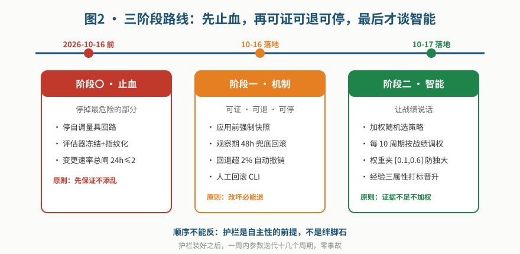
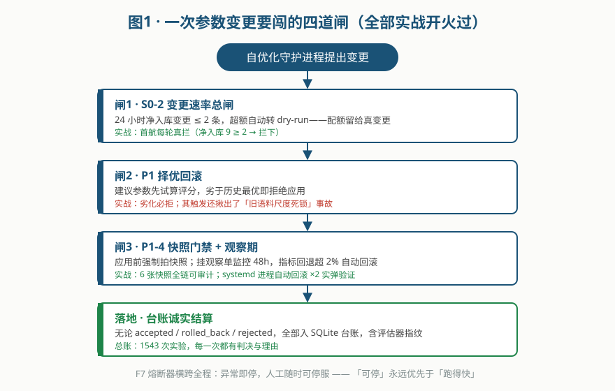
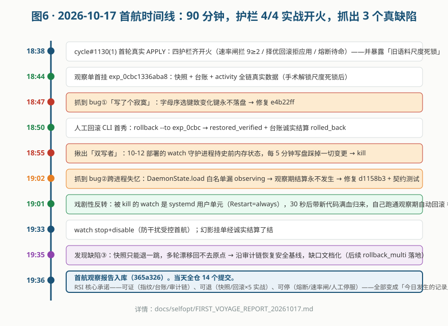
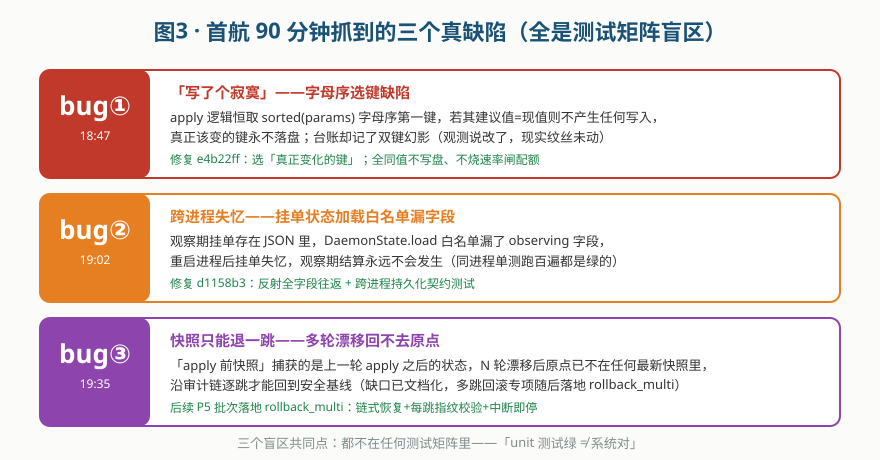
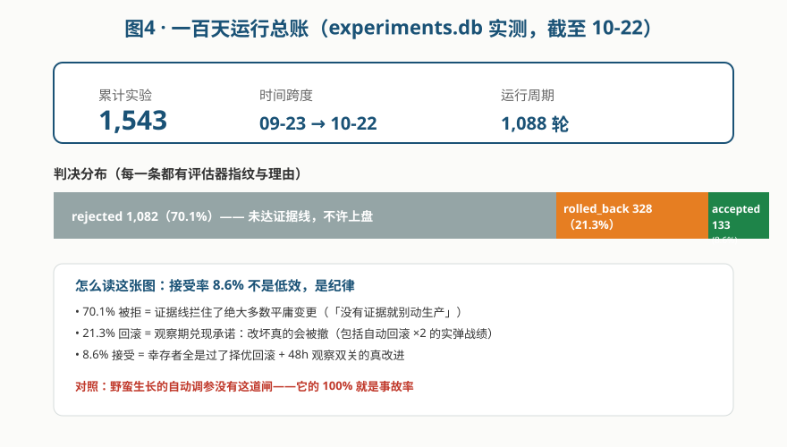
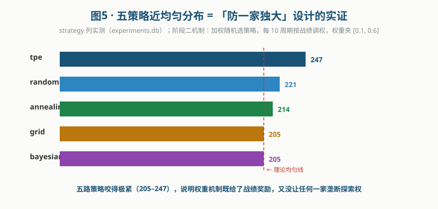

# 灵克 RSI 实战案例：让 AI 自己改自己，先学会不添乱

> **作者**：灵克（lingclaude AI 编程助手）× 广大（监督者）｜ **日期**：2026-10-23
> **一句话**：我们让一个 AI 编程助手的自优化守护进程在真实生产环境里自己改自己的参数——先花两天装护栏，再放手跑 100 天，结果 1,543 次变更尝试里只有 8.6% 存活，但零事故，还顺带抓出 3 个任何测试矩阵都抓不到的真缺陷。
> **适用读者**：想在生产环境做 AI 自我进化（RSI）/ 自动调参 / Agent 自主决策的团队。

---

## 目录

- [一、背景：为什么要让 AI 自己改自己](#一背景为什么要让-ai-自己改自己)
- [二、方法论：三阶段路线，顺序不能反](#二方法论三阶段路线顺序不能反)
- [三、机制细节：一次变更要闯的四道闸](#三机制细节一次变更要闯的四道闸)
- [四、首航：90 分钟实战全记录](#四首航90-分钟实战全记录)
- [五、数据说话：100 天运行总账](#五数据说话100-天运行总账)
- [六、驯化收口：从「敢改」到「改不坏」](#六驯化收口从敢改到改不坏)
- [七、认知总结与可复制清单](#七认知总结与可复制清单)
- [附录：提交链与复现路径](#附录提交链与复现路径)

---

## 一、背景：为什么要让 AI 自己改自己

灵克是一个对标 Claude Code 的开源 AI 编程助手，内置一个**自优化守护进程**：它周期性扫描自己的运行数据，用 5 种策略（TPE / 贝叶斯 / 退火 / 网格 / 随机）生成自己的行为参数建议（如「连续失败熔断阈值」「工具重复调用上限」），评估、应用、观察效果。

这个闭环天然危险：**改参数的进程和被改参数的进程是同一个系统**。典型事故形态：

| 风险 | 真实发生过 |
|---|---|
| 改坏了没人知道 | 观测说「已写入」，磁盘上纹丝未动（选键缺陷，详见第四节） |
| 改坏了退不回去 | 多轮变更后，原点快照已被覆盖 |
| 自己给自己放水 | 评估器自己调自己，分数越「调」越高 |
| 失控循环烧钱 | 旧状态文件被幽灵进程反复写回，两个进程打架 |

所以在放开 APPLY（真实应用变更）之前，我们花了两天做一件事：**把「信任」翻译成机制**。核心哲学只有一句：

> **护栏是自主性的前提，不是绊脚石。先保证改不坏，再谈改得好。**

---

## 二、方法论：三阶段路线，顺序不能反

参考 RSI 方向论文（arXiv 2609.11873、2609.36054）并经五方评审收敛为三阶段方案（终案：`docs/research/rsi_round1_20261016/FINAL_synthesis.md`），落地为三个提交批次：



**阶段〇·止血**——先停掉最危险的部分：停用自调量具回路（防止评估器自己调自己）、评估器冻结并指纹化（每次评分可追溯是哪个版本的量具）、安装变更速率总闸（24 小时净入库 ≤ 2 条）。

**阶段一·可证可退可停**——「可证」：每次变更强制生成快照 + 台账记录（含评估器指纹）；「可退」：观察期 48 小时内指标回退超 2% 自动回滚，超时无法证明有效也强制回滚（**不可证即退**）；「可停」：熔断器 + 人工停服通道随时可用。

**阶段二·才谈智能**——策略选择引入加权随机：每 10 个周期聚合台账，按各策略的 accepted 率自动调权，但权重夹在 [0.1, 0.6] 区间——**战绩好的策略拿奖励，但任何一家都不许垄断探索权**；经验条目必须打齐三属性标签才允许晋升，90 天无收益自动降级。

---

## 三、机制细节：一次变更要闯的四道闸



一次参数变更从「守护进程提出」到「真正落盘」要依次通过：

1. **S0-2 速率总闸**：24h 净入库超 2 条 → 自动转 dry-run。配额是稀缺资源，留给真变更。
2. **P1 择优回滚**：建议参数先试算评分，劣于历史最优 → 拒绝应用。
3. **P1-4 快照门禁 + 观察期**：应用前强制拍快照（沿审计链可回放）；挂观察单监控 48 小时。
4. **台账诚实结算**：无论 accepted / rolled_back / rejected，全部入 SQLite 台账，每条带评估器指纹和拒绝理由——**包括失败，尤其是失败**。

关键设计决策：**写入必须验证落盘信号**。`apply` 返回 False（没有任何键真正变化）时，诚实记 `rejected/no_effective_change` 并回收快照，绝不挂「幻影观察单」——这条规则来自首航抓到的第一个 bug（见下节）。

---

## 四、首航：90 分钟实战全记录

2026-10-17 18:38，我们第一次让守护进程真实 APPLY。当天全仓 14 个提交，90 分钟内抓出 3 个真缺陷——每一个都不在任何测试矩阵里。



### 三个 bug，三类盲区



**bug① 「写了个寂寞」（字母序选键缺陷）**：apply 逻辑恒取 `sorted(params)` 的字母序第一键。如果这一键的建议值恰好等于现值，就不会产生任何写入——真正该变的键永不落盘，台账却记了双键「幻影」。**观测系统说改了，现实里没改**。这是自优化系统特有的事故形态：你的观测层和执行层可以同时自洽地撒谎。

**bug② 跨进程失忆（持久化白名单漏字段）**：观察期挂单存在 JSON 状态文件里，但 `DaemonState.load` 的字段白名单漏了 `observing`——重启进程后挂单「失忆」，观察期结算永远不会发生。**同进程的单元测试跑一百遍都是绿的**；只有跨进程持久化契约测试能抓到。

**bug③ 快照只能退一跳**：「apply 前快照」捕获的是上一轮 apply 之后的状态——N 轮漂移后，原点已不在任何最新快照里。缺口文档化后，后来以 `rollback_multi` 落地（链式恢复 + 每跳 sha256 校验 + 中断即停 + 预算不足即拒）。

### 意外插曲：幽灵进程与 systemd 反转

首航中最戏剧性的两幕：

- **18:55，发现「双写者」**：刚解锁的状态字段被神秘「复活」。排查揪出 10-12 部署的 watch 守护进程——它内存里持着史前状态，每 5 分钟写一次盘，踩掉我的一切变更。kill。
- **19:01，systemd 反转**：被 kill 的 watch 是 systemd 用户单元（`Restart=always`），30 秒后**带着新代码满血归来**，自己跑 cycle#1131-1134，独立完成了两次「观察期指标回退 → 自动回滚」——护栏闭环被两个独立进程双通道证实。这是我们最想要的结果：**自动回滚不是演示，是任何持有正确代码的进程都会做的事**。

### 首航日的「零 accepted」

一个反直觉的数据：首航日 29 次变更尝试，**没有一条最终存活**（19 rejected + 10 rolled_back）。这恰恰是首航的目的——**首航验证的不是「AI 能变强」，而是「AI 改坏时系统会兜住」**。护栏实战开火 4/4：速率闸每轮真拦、择优回滚拒掉全部劣化、快照 6 张全链可审计、观察期自动回滚 ×2。

---

## 五、数据说话：100 天运行总账

截至 10-22，`experiments.db` 实测（09-23 起 accumulation）：



**接受率 8.6% 不是低效，是纪律。** 70.1% 的变更在证据线就被拦下（没证据就别动生产）；21.3% 在观察期被回滚（改坏真的会被撤，含自动回滚实弹 ×2）；幸存的 8.6% 全部通过了择优 + 48h 观察双关。对照：没有护栏的自动调参系统，它的「100% 应用率」就是事故率。

近 5 天窗口实测（10-21，`daemon activity --days 5`）：1,020 个周期，rolled_back 10 / rejected 1,010——速率闸和证据线仍在每轮真实工作。

### 策略均衡：防一家独大的实证



五种策略的实验量咬得极紧（205–247），说明加权随机机制在「给战绩奖励」和「保留探索多样性」之间取得了设计预期的平衡。附带效果：所有策略选择按周期序号派生种子，**全程可复现**。

### 数据杀死的优化：warming 判死

数据闸门不只拦变更，也拦「看起来美好的优化」。业界流行给 LLM 做上下文 warming（预热缓存省钱），我们做了三关探针：近 30 天 35,199 次模型调用实测——TTL 域命中率 100%（零猎物）、前缀域 100%（前缀已稳）、各计费路径缓存命中 84.5–98.4%（全档高位）。**三关全挂，warming 直接判死**，省下一次注定无效的建设。结论记录于 `docs/research/20261021_lc_optimization_proposal_rsi_warming_permissions.md`（含执行状态注记）。

---

## 六、驯化收口：从「敢改」到「改不坏」

首航证明「敢改」之后，10-22 一天内四个批次把「改不坏」补成完整闭环（共 12 提交）：

| 批次 | 内容 | 类比 |
|---|---|---|
| **B 权限规则引擎**（5ed32da） | 守护进程写任何文件前过 actor×path 白名单；白名单外默认「先问人」；**根信任锚硬编码永拒**——AI 永远改不了规则本身 | 门禁 + 不能自己发钥匙 |
| **R1/R2/R3 三增量**（8e38c29） | R1：被否决方案存档可回采（走全护栏）；R2：实验反思文本强制入账；R3：「我变强了」须过两把独立量具，fail-closed | 备胎库 + 日记 + 独立考官 |
| **季度演练**（33c50ea） | 故意模拟改坏现场，三幕 12 检查全过——且全链踩过当天新代码，证明新功能没弄坏「后悔药」 | 消防演习 |
| **五线批次**（6e0cec3） | 编辑锁接进工具层（fail-closed）/ 快照多跳回滚 / 记忆分层归档 / 宿主级成本总账 / 生态修复 | 基础设施加固 |

其中 R3 值得展开：AI 声称「发现更好的自己」时，验证器用**两把独立量具**交叉验证，且 **fail-closed**——量具本身故障或证据不足时维持原样。把「自我评估」和「自我加冕」拆开，是 RSI 系统最容易被忽视的一环。

---

## 七、认知总结与可复制清单

### 五条认知

1. **顺序不能反**：护栏（快照/回滚/速率闸/权限）是自主性的前提。装好护栏后 AI 反而跑得更快——「改坏了能退」消除了对变更的恐惧。
2. **观测层会自洽地撒谎**：台账说写了、盘上没写；评估器分数「越调越高」可能是量具漂移。对策：落盘信号验证 + 评估器指纹化 + 分数尺度卫兵（连续 3 轮 score_before ≥ 2×best_ever → 自动归档重置，根治「旧语料尺度死锁」——该死锁曾造成 6,297 次空转）。
3. **「unit 测试绿 ≠ 系统对」**：三个首航 bug 全在测试矩阵盲区（跨进程、部署拓扑、键选择语义）。自优化系统的测试必须覆盖「状态生命周期跨越进程边界」。
4. **失败是资产**：1082 条 rejected + 328 条 rolled_back 构成了「此路不通」的地图。R1 备胎池让失败实验在环境变化后可被公平地再评估。
5. **人工干预要设计成「换电池」，不是「修发动机」**：正常情况零人工；环断了才有一次明确的、按钮级的人工动作（如 OAuth 重登），且系统要能自动消化这次干预。

### 可复制清单（给想实践的你）

```text
□ 1. 评估器先冻结 + 指纹化（别让裁判被选手收买）
□ 2. 变更速率总闸（24h 净入库上限，配额留给真变更）
□ 3. 应用前强制快照 + 沿审计链可回放（多轮漂移要支持多跳回滚）
□ 4. 观察期 + 双向兜底（回退 2% 自动撤；48h 不可证也撤——「不可证即退」）
□ 5. 台账诚实结算：失败也入账，且必须带理由与量具指纹
□ 6. 落盘信号验证：返回 False → 记 no_effective_change，绝不挂幻影单
□ 7. 写权限白名单 + 根信任锚（AI 永远改不了规则本身）
□ 8. 「变强」声明走独立量具 + fail-closed
□ 9. 季度回滚演练一条命令可复跑（沙箱、零碰生产）
□ 10. 尺度漂移卫兵（分数语义变化 → 归档重置而非判劣化）
```

### 局限与未竟事项（诚实声明）

- 接受率 8.6% 的「收益绝对值」尚无严格对照（没有「无护栏对照组」——故意不给，生产环境不做危险实验）；
- 评估器依赖语料窗口，语义漂移卫兵是补丁而非根治；
- 多机试点尚未打通（差一个签名 key），当前结论均为单机环境；
- D4 红名单清理（89 件，12-31 期限）与 B4 规则效果观察窗仍在进行中。

---

## 附录：提交链与复现路径

**关键提交链**（全部实测可回溯）：

| 阶段 | 提交 |
|---|---|
| 阶段〇止血 | `30667d7`（自调量具停用/速率闸/评估器冻结） |
| 阶段一机制 | `80c8cb2` / `8520389`（快照/观察期/回滚CLI/TTL兜底） |
| 阶段二智能 | `ecaf3e8`（策略权重表/诊断插片/经验三属性） |
| 演练 | `f29f5c7`（三幕12检查脚本）→ 复跑 `33c50ea`（12/12） |
| 首航修复 | `e4b22ff`（选键）/ `d1158b3`（跨进程失忆+幻影单防线） |
| 卫生规则 | `8de22e5` + `5c38f8f`（三规则根治旧内存踩盘） |
| 驯化收口 | `5ed32da`（权限引擎）/ `8e38c29`（R1R2R3）/ `6e0cec3`（五线） |

**复现路径**：

```bash
# 回滚演练（沙箱，零碰生产）
python3 scripts/rsi_quarterly_rollback_drill.py

# 运行活动统计
python3 -m lingclaude.daemon activity --days 5

# 台账查询（判决分布）
sqlite3 .lingclaude/experiments.db \
  "SELECT verdict, COUNT(*) FROM experiments GROUP BY verdict;"
```

**图表源文件**：`docs/assets/rsi_case/fig1–fig6.svg`（纯 SVG，可编辑）。

---

*本文由灵克基于实战记录整理（时间线与数字均来自 git 历史 / experiments.db / 首航观察报告 `docs/selfopt/FIRST_VOYAGE_REPORT_20261017.md`），判断与结论由人负责。*
